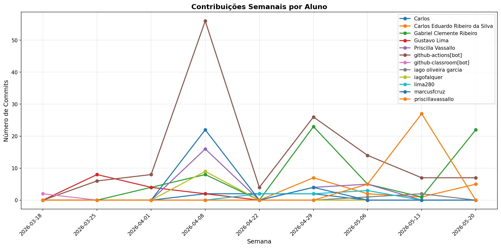

# 📊 Relatório de Contribuições do Projeto

**Última atualização:** 27/05/2026 19:14

---

## 📈 Resumo Geral de Contribuições

| Aluno                           |   Commits |   Linhas+ |   Linhas- |   Arquivos |   Docs Commits |   Docs Arquivos |
|---------------------------------|-----------|-----------|-----------|------------|----------------|-----------------|
| Carlos                          |         6 |        26 |        14 |          2 |              6 |               1 |
| Carlos Eduardo Ribeiro da Silva |        15 |      9698 |       740 |         76 |              3 |               9 |
| Gabriel Clemente Ribeiro        |        63 |      2657 |      1222 |         34 |             27 |               2 |
| Gustavo Lima                    |        14 |       258 |       120 |          5 |             14 |               2 |
| Priscilla Vassallo              |        25 |       266 |       199 |          2 |             25 |               1 |
| github-actions[bot]             |       128 |       812 |       730 |          3 |            128 |               1 |
| github-classroom[bot]           |         2 |      1548 |         0 |         19 |              2 |               3 |
| iago oliveira garcia            |         3 |       368 |       174 |         17 |              0 |               0 |
| iagofalquer                     |         9 |        98 |       119 |          1 |              9 |               1 |
| lima280                         |         7 |      2147 |       124 |         31 |              0 |               0 |
| marcusfcruz                     |        26 |       930 |       128 |          6 |             22 |               1 |
| priscillavassallo               |        32 |      5473 |      2209 |         24 |              1 |               0 |

## 📅 Contribuições Semanais (Todo o Semestre)

**2026-05-20**: Carlos Eduardo Ribeiro da Silva: 5, Gabriel Clemente Ribeiro: 22, github-actions[bot]: 7

**2026-05-13**: Carlos Eduardo Ribeiro da Silva: 1, Gabriel Clemente Ribeiro: 1, github-actions[bot]: 7, iago oliveira garcia: 2, priscillavassallo: 27

**2026-05-06**: Carlos Eduardo Ribeiro da Silva: 2, Gabriel Clemente Ribeiro: 5, Priscilla Vassallo: 5, github-actions[bot]: 14, iago oliveira garcia: 1, lima280: 3, priscillavassallo: 5

**2026-04-29**: Carlos: 2, Carlos Eduardo Ribeiro da Silva: 7, Gabriel Clemente Ribeiro: 23, Priscilla Vassallo: 4, github-actions[bot]: 26, lima280: 2, marcusfcruz: 4

**2026-04-22**: Carlos: 2, github-actions[bot]: 4, lima280: 2

**2026-04-08**: Carlos: 2, Gabriel Clemente Ribeiro: 8, Gustavo Lima: 2, Priscilla Vassallo: 16, github-actions[bot]: 56, iagofalquer: 9, marcusfcruz: 22

**2026-04-01**: Gabriel Clemente Ribeiro: 4, Gustavo Lima: 4, github-actions[bot]: 8

**2026-03-25**: Gustavo Lima: 8, github-actions[bot]: 6

**2026-03-18**: github-classroom[bot]: 2

## 📊 Visualização Gráfica

## ℹ️ Observações

- **Commits**: Número total de commits realizados

- **Linhas+**: Linhas de código adicionadas

- **Linhas-**: Linhas de código removidas

- **Arquivos**: Número de arquivos únicos modificados

- **Docs Commits**: Commits em arquivos de documentação

- **Docs Arquivos**: Arquivos de documentação modificados

---

*Relatório gerado automaticamente via GitHub Actions*
