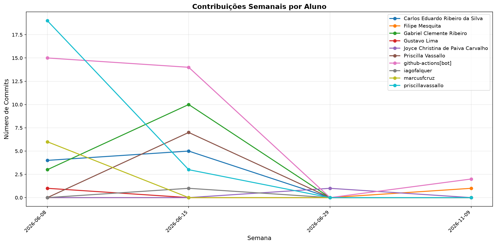

# 📊 Relatório de Contribuições do Projeto

**Última atualização:** 16/11/2026 04:26

---

## 📈 Resumo Geral de Contribuições

| Aluno                             |   Commits |   Linhas+ |   Linhas- |   Arquivos |   Docs Commits |   Docs Arquivos |
|-----------------------------------|-----------|-----------|-----------|------------|----------------|-----------------|
| Carlos                            |         9 |        45 |        35 |          3 |              6 |               1 |
| Carlos Eduardo Ribeiro da Silva   |        31 |      4590 |      1334 |         38 |              2 |               0 |
| Filipe Mesquita                   |         1 |         0 |         0 |          3 |              1 |               0 |
| Gabriel Clemente Ribeiro          |       101 |      3998 |      1666 |         46 |             38 |               3 |
| Gustavo Lima                      |        16 |       260 |       124 |          6 |             15 |               2 |
| Joyce Christina de Paiva Carvalho |         1 |         0 |         1 |          1 |              0 |               0 |
| Priscilla Vassallo                |        32 |       278 |       248 |          4 |             29 |               1 |
| github-actions[bot]               |       189 |      1280 |      1198 |          3 |            189 |               1 |
| github-classroom[bot]             |         2 |      1548 |         0 |         19 |              2 |               3 |
| iago oliveira garcia              |         3 |       368 |       174 |         17 |              0 |               0 |
| iagofalquer                       |         9 |        93 |       117 |          2 |              8 |               1 |
| lima280                           |         9 |      2345 |       145 |         34 |              0 |               0 |
| marcusfcruz                       |        45 |      3918 |      1601 |         20 |             22 |               1 |
| priscillavassallo                 |        84 |     10859 |      6451 |         57 |              1 |               0 |

## 📅 Contribuições Semanais (Todo o Semestre)

**2026-11-09**: Filipe Mesquita: 1, github-actions[bot]: 1

**2026-06-29**: Joyce Christina de Paiva Carvalho: 1

**2026-06-15**: Carlos Eduardo Ribeiro da Silva: 5, Gabriel Clemente Ribeiro: 10, Priscilla Vassallo: 7, github-actions[bot]: 14, iagofalquer: 1, priscillavassallo: 3

**2026-06-08**: Carlos Eduardo Ribeiro da Silva: 4, Gabriel Clemente Ribeiro: 3, Gustavo Lima: 1, github-actions[bot]: 15, marcusfcruz: 6, priscillavassallo: 19

**2026-06-01**: Carlos: 1, Gabriel Clemente Ribeiro: 14, Gustavo Lima: 1, github-actions[bot]: 21, lima280: 2, marcusfcruz: 6, priscillavassallo: 27

## 📊 Visualização Gráfica

## ℹ️ Observações

- **Commits**: Número total de commits realizados

- **Linhas+**: Linhas de código adicionadas

- **Linhas-**: Linhas de código removidas

- **Arquivos**: Número de arquivos únicos modificados

- **Docs Commits**: Commits em arquivos de documentação

- **Docs Arquivos**: Arquivos de documentação modificados

---

*Relatório gerado automaticamente via GitHub Actions*
